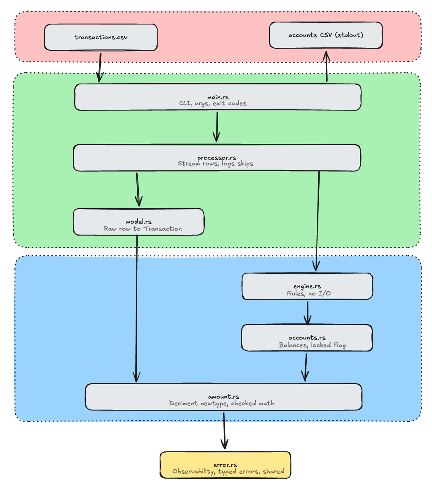
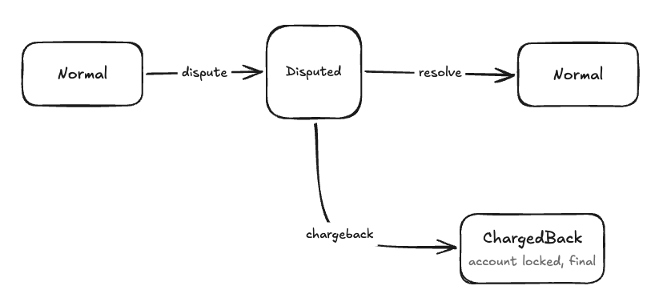

# Architecture

## Layers

The codebase is organized into distinct layers where dependencies strictly point inward and downward:

- **`src/domain/`**: Pure business logic with zero I/O dependencies.
  - `amount`: `Amount` newtype wrapping `rust_decimal::Decimal` with checked arithmetic.
  - `account`: `Account` tracking client balances and invariant preservation.
  - `engine`: `Engine` handling transactions and dispute state transitions.
- **`src/io/`**: I/O adapters for ingestion and serialization.
  - `model`: `RawRecord` deserialization and conversion into domain `Transaction`.
  - `processor`: Streaming `csv::Reader` processing, aggregated error diagnostics, and CSV serialization.
- **`src/error.rs`**: Typed domain, parsing, and engine errors shared across layers.
- **`src/main.rs`**: Entry point handling CLI flags, buffered files, and exit codes.

The engine has no I/O, so it can be tested in memory and reused in a server unchanged.

## Data flow

1. `csv::Reader` (trimmed, flexible) yields one `RawRecord` at a time.
2. `Transaction::try_from(RawRecord)` validates type, amount presence, positivity and precision.
3. `Engine::apply` mutates state or returns an `EngineError`.
4. Errors are logged to stderr with the line number and skipped.
5. At end of input, `write_accounts` prints sorted rows.

## State

- `accounts: HashMap<u16, Account>`
- `deposits: HashMap<u32, StoredDeposit { client, amount, state }>`

Dispute state machine (per deposit):

| Operation | available | held | total |
| --- | --- | --- | --- |
| deposit | +a | | +a |
| withdrawal (if available >= a) | -a | | -a |
| dispute | -a | +a | = |
| resolve | +a | -a | = |
| chargeback | | -a | -a, lock |

## Scaling to concurrent streams

- Each TCP connection runs `process` on its own task. Engine state must then be shared or partitioned.
- Partition by client id (`client % N`) into N shards, each owned by one worker fed through a channel. All operations for one client stay ordered; shards need no locks.
- Transaction ids are global, but a dispute is validated against the owning client, so the deposit index can live inside the client's shard.
- Add backpressure with bounded channels; persist the deposit index (e.g. an embedded KV store) if it must exceed RAM.
